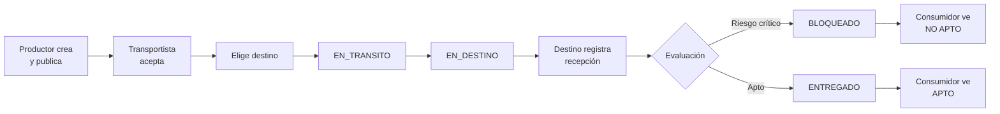
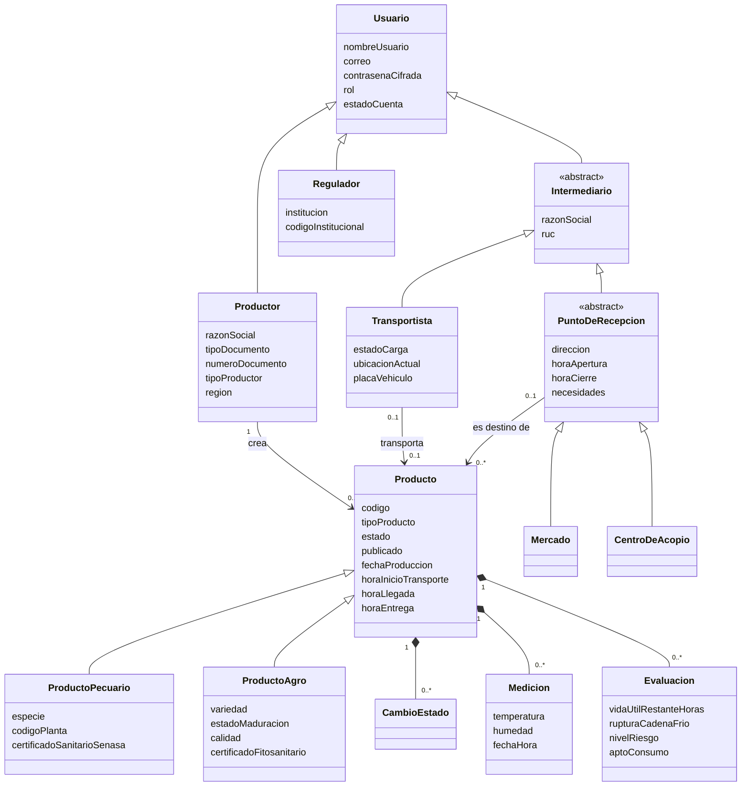
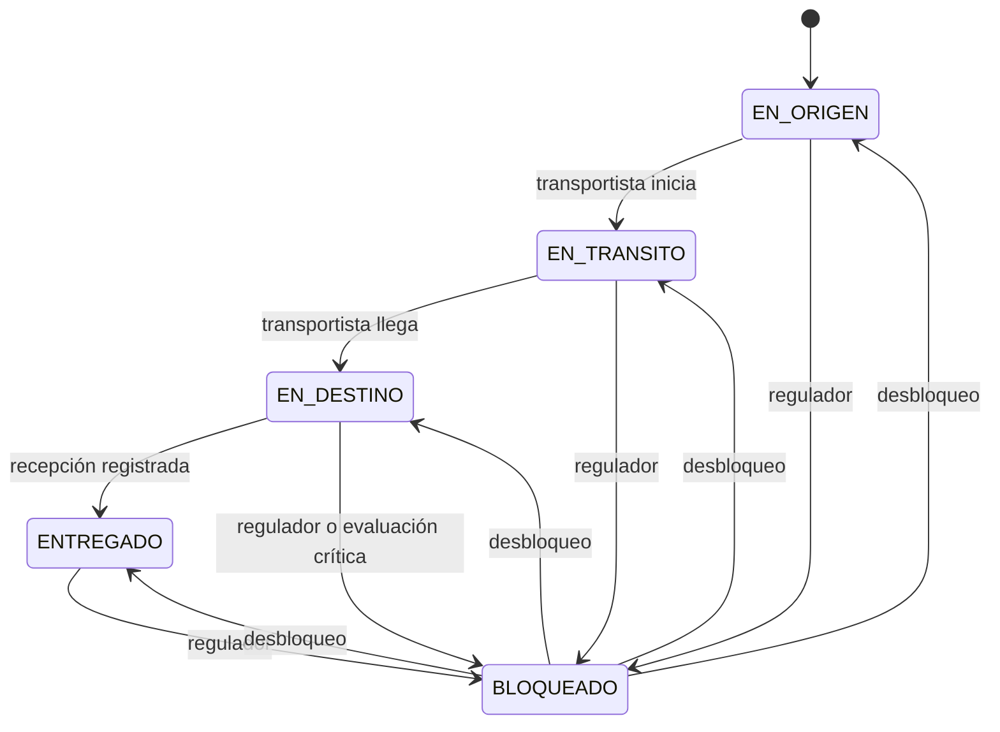

# QRUTA — Especificación de la fase 2

Plataforma de trazabilidad de productos perecibles (pollo, palta y banano) desde el productor hasta el consumidor final.

Este documento continúa el trabajo ya construido en el repositorio `lab4` y define todo lo necesario para la entrega del sábado: requisitos, actores, casos de uso, modelo de dominio, reglas de negocio, diseño técnico, plan de pruebas TDD, plan de trabajo y despliegue.

---

## 0. Instrucciones para Claude Code

1. **Lee primero el código existente** y la bitácora `docs/bitacora-tdd.md`. Los nombres de clases y métodos de este documento son una guía: si en el código ya existe algo equivalente, respeta el nombre existente.
2. **Las 21 pruebas actuales (T01 a T21) deben seguir en verde** en todo momento. Ningún cambio puede romperlas.
3. **Si una regla nueva contradice una prueba existente, DETENTE y avísame** antes de tocar nada. Una prueba solo puede modificarse cuando cambia el requisito, nunca para que el código pase, y ese cambio se registra en la bitácora como "cambio de requisito".
4. Se mantienen las reglas TDD de `CLAUDE.md`: una prueba a la vez, RED → GREEN → REFACTOR, un commit por fase (`test`, `feat`, `refactor`), sin `amend`, `rebase` ni `push --force`, y sin la línea de coautoría.
5. En esta fase **no hace falta detenerse para capturas** después de cada RED y GREEN, salvo que yo lo pida. Sí hay que guardar la salida de cada ejecución en `docs/evidencias/`.
6. Si una prueba nueva pasa sin escribir código, **no la cuentes como ciclo**: regístrala en la bitácora como prueba de confirmación.
7. Trabaja en el orden de prioridades de la sección 12. Al terminar cada ciclo, actualiza la bitácora y el README.
8. Todo el código de dominio sigue siendo Java puro, sin Spring, y toda hora se toma de un `java.time.Clock` inyectado.

---

## 1. Problema y objetivo

**Problema.** En el Perú, gran parte de los productos perecibles se comercializa de manera informal. No existen registros confiables del recorrido de cada lote, de las condiciones en que se transportó ni de su estado al llegar al mercado. El consumidor final no puede saber si lo que compra es apto para el consumo. Las plataformas oficiales existentes, como el SIEA del MIDAGRI, muestran estadísticas agregadas, pero no permiten seguir un producto concreto en tiempo cercano al real.

**Objetivo de la plataforma.** Conectar a productores, transportistas, mercados y centros de acopio en un mismo flujo, de modo que cada lote quede registrado desde su origen, cada traslado deje constancia de quién lo hizo y cuándo, cada recepción mida sus condiciones de conservación, y cualquier persona pueda consultar con un código QR si el producto es apto para el consumo.

**Objetivo de la entrega del sábado.** Una plataforma desplegada en internet que muestre ese flujo completo funcionando de principio a fin, con reglas que impidan los usos indebidos y sin errores durante la demostración.

---

## 2. Línea base: lo que ya existe en `lab4`

**Funcionalidad construida con TDD (7 ciclos, 21 pruebas, 96 % de cobertura de líneas):**

- Creación de productos que nacen en EN_ORIGEN, con un intermediario asignado desde el inicio.
- Máquina de estados EN_ORIGEN → EN_TRANSITO → EN_DESTINO → ENTREGADO, sin saltos ni retrocesos.
- Hora de inicio del transporte y hora de llegada tomadas del reloj del sistema, y cálculo de la duración del transporte.
- Permisos: solo el intermediario asignado puede cambiar la etapa.
- Historial de cambios de estado con hora y autor.
- Visibilidad por rol: el productor ve lo que creó, el intermediario lo que tiene asignado y el regulador todo.
- Login simple con usuarios de prueba, PostgreSQL con Docker y una página web de demostración.

**Reglas ya vigentes (se mantienen):**

- **RE-01.** Todo producto nuevo empieza en EN_ORIGEN.
- **RE-04.** Solo el intermediario asignado puede cambiar la etapa del producto.
- **RE-05.** La etapa avanza de una en una, sin saltos ni retrocesos.
- **RE-06.** Un producto ENTREGADO no puede cambiar de etapa.
- **RE-07.** Al pasar a EN_TRANSITO se guarda la hora de inicio; al pasar a EN_DESTINO, la de llegada.
- **RE-08.** La duración del transporte solo se calcula cuando existen ambas horas.
- **RE-09.** Cada cambio queda en el historial con su hora y su autor.
- **RE-10.** Cada rol ve solo los productos que le corresponden (se amplía en esta fase).

---

## 3. Requisitos

### 3.1 Requisitos funcionales

Prioridad: **M** = imprescindible para el sábado, **S** = importante si hay tiempo, **C** = deseable, **F** = solo diseño, para una fase futura.

**Cuentas y acceso**

- **RF-01 (M).** Productores, transportistas, mercados y centros de acopio se registran por sí mismos en la plataforma.
- **RF-02 (M).** Las cuentas registradas quedan pendientes hasta que la autoridad correspondiente las aprueba.
- **RF-03 (M).** Los usuarios inician y cierran sesión de forma segura.
- **RF-04 (S).** El administrador crea las cuentas de los reguladores con un código institucional.

**Productos**

- **RF-05 (M).** El productor crea productos de tipo pollo, palta o banano, con sus datos de origen y sanitarios.
- **RF-06 (M).** Cada producto recibe un código QR único.
- **RF-07 (M).** El productor publica sus productos para que los transportistas puedan tomarlos.

**Transporte**

- **RF-08 (M).** El transportista publica su ubicación y su estado de carga (libre u ocupado).
- **RF-09 (M).** El transportista ve las publicaciones disponibles y acepta una.
- **RF-10 (M).** El transportista elige el mercado o centro de acopio de destino.
- **RF-11 (M).** El transportista avanza el producto por las etapas del recorrido (ya existe).

**Recepción y evaluación**

- **RF-12 (M).** El mercado o centro de acopio configura su ubicación, horario y los tipos de producto que necesita.
- **RF-13 (M).** El destino registra la recepción del producto con la temperatura y la humedad medidas.
- **RF-14 (M).** Cada recepción genera una evaluación: vida útil restante, ruptura de la cadena de frío, nivel de riesgo y aptitud para el consumo.
- **RF-15 (M).** Un producto con riesgo crítico se bloquea automáticamente.

**Control y consulta**

- **RF-16 (M).** Cualquier persona consulta un producto con su código QR, sin registrarse.
- **RF-17 (M).** El regulador activa y suspende a productores y transportistas.
- **RF-18 (M).** El regulador bloquea y desbloquea productos.
- **RF-19 (S).** El regulador descarga un archivo CSV con las métricas sanitarias.
- **RF-20 (S).** El administrador ve un panel con todos los actores, los productos y sus recorridos.

**Fase futura (solo diseño)**

- **RF-21 (F).** Ubicación GPS del transportista en tiempo real y mediciones automáticas durante el trayecto.
- **RF-22 (F).** Puntuación de los transportistas.
- **RF-23 (F).** Licencias con fecha de vencimiento.
- **RF-24 (F).** Aplicación móvil nativa.

### 3.2 Requisitos no funcionales

- **RNF-01, disponibilidad.** La plataforma está desplegada y accesible por internet mediante HTTPS durante la demostración. *(Posterior al avance del sábado: ver la sección 13.)*
- **RNF-02, seguridad.** Las contraseñas se guardan cifradas con BCrypt, nunca se devuelven en ninguna respuesta, y las operaciones protegidas exigen una sesión válida.
- **RNF-03, privacidad.** La consulta pública nunca expone correos, documentos de identidad, teléfonos ni contraseñas.
- **RNF-04, integridad.** El historial no se modifica: las correcciones se registran como eventos nuevos.
- **RNF-05, usabilidad.** La interfaz web funciona en el celular (diseño adaptable), lo que cubre en esta fase la necesidad de consulta móvil.
- **RNF-06, mantenibilidad.** Todo el dominio y los servicios se construyen con TDD, con cobertura de líneas de al menos 90 %.
- **RNF-07, portabilidad.** La aplicación se ejecuta en un contenedor Docker y se configura mediante variables de entorno.
- **RNF-08, rendimiento.** Las operaciones comunes responden en menos de 2 segundos con hasta 100 productos.

---

## 4. Actores y roles

- **Productor.** Registra y publica sus productos. Puede ser persona natural (con DNI) o empresa (con RUC), y declara si es agrícola, pecuario o agropecuario.
- **Transportista** (intermediario). Publica su ubicación y su estado de carga, acepta productos, elige su destino y los traslada.
- **Mercado** (intermediario). Punto de destino donde se recibe el producto. Configura su horario y sus necesidades.
- **Centro de acopio** (intermediario). Igual que el mercado, pero orientado a la consolidación de lotes.
- **Regulador** (por ejemplo, SENASA). Aprueba a productores y transportistas, bloquea productos riesgosos, revisa recorridos y descarga reportes sanitarios.
- **Administrador.** Gestiona la plataforma: crea reguladores, aprueba mercados y centros de acopio, y ve el panel general. No tiene poder sanitario.
- **Consumidor final.** Consulta un producto con su código QR. No tiene cuenta.

---

## 5. Casos de uso

Cada caso indica su actor principal, lo que hace y las reglas que lo gobiernan. Entre paréntesis, el caso de uso del negocio del Entregable 1 al que corresponde.

- **CU-01 Registrarse** (M). Actor: productor, transportista, mercado o centro de acopio. Completa sus datos y su cuenta queda PENDIENTE. Reglas: RE-11 a RE-15. (CUN-01)
- **CU-02 Iniciar sesión** (M). Actor: cualquier usuario con cuenta. Recibe un token de sesión. Reglas: RE-16, RE-17.
- **CU-03 Aprobar o suspender una cuenta** (M). Actor: regulador o administrador, según el tipo de cuenta. Reglas: RE-15, RE-35. (CUN-03)
- **CU-04 Crear un regulador** (S). Actor: administrador. Reglas: RE-11, RE-40.
- **CU-05 Crear un producto** (M). Actor: productor. El producto nace en EN_ORIGEN con su código QR. Reglas: RE-01, RE-02, RE-18, RE-19. (CUN-04)
- **CU-06 Publicar un producto** (M). Actor: productor. Reglas: RE-20, RE-21.
- **CU-07 Configurar un punto de recepción** (M). Actor: mercado o centro de acopio. Define ubicación, horario y tipos de producto que necesita.
- **CU-08 Publicar ubicación y estado de carga** (M). Actor: transportista.
- **CU-09 Aceptar un producto** (M). Actor: transportista. Reglas: RE-22, RE-23.
- **CU-10 Elegir el destino** (M). Actor: transportista. Reglas: RE-24, RE-25.
- **CU-11 Cambiar la etapa del producto** (M, ya existe). Actor: transportista asignado. Reglas: RE-04 a RE-09, RE-27, RE-28. (CUN-05)
- **CU-12 Registrar la recepción** (M). Actor: mercado o centro de acopio de destino. Registra la medición y desencadena la evaluación. Reglas: RE-26, RE-29 a RE-32. (CUN-06)
- **CU-13 Bloquear o desbloquear un producto** (M). Actor: regulador. Reglas: RE-33, RE-34. (CUN-07)
- **CU-14 Descargar el reporte sanitario** (S). Actor: regulador. Regla: RE-36. (CUN-09)
- **CU-15 Consultar un producto por QR** (M). Actor: consumidor final. Reglas: RE-37 a RE-39. (CUN-08)
- **CU-16 Ver el panel general** (S). Actor: administrador. Regla: RE-40.

### Flujo principal de la plataforma



---

## 6. Modelo de dominio

### 6.1 Usuarios

Se combina un **rol** (que decide los permisos) con **herencia** (que agrupa los datos propios de cada actor).

- **Usuario** (clase base, concreta): id, nombreUsuario, nombreCompleto, correo, contrasenaCifrada, rol, estadoCuenta.
- **Productor** (hereda de Usuario): razonSocial, tipoDocumento (DNI o RUC), numeroDocumento, telefono, tipoProductor (AGRICOLA, PECUARIO o AGROPECUARIO), distrito, provincia, region.
- **Intermediario** (abstracta, hereda de Usuario): razonSocial, ruc, telefono.
- **Transportista** (hereda de Intermediario): estadoCarga (LIBRE u OCUPADO), ubicacionActual (texto), region, placaVehiculo.
- **PuntoDeRecepcion** (abstracta, hereda de Intermediario): direccion, distrito, provincia, region, horaApertura, horaCierre, necesidades (conjunto de TipoProducto), disponible.
- **Mercado** y **CentroDeAcopio** (heredan de PuntoDeRecepcion).
- **Regulador** (hereda de Usuario): institucion, codigoInstitucional.
- **Administrador:** es un Usuario con rol ADMINISTRADOR.

### 6.2 Productos

- **Producto** (clase base, concreta): id, codigo (el valor del QR), nombre, tipoProducto, tipoProduccion (ORGANICO o ESTANDAR), lote, productor, intermediarioAsignado, destino, publicado, estado, estadoAntesDelBloqueo, motivoBloqueo, fechaProduccion, fechaRegistro, horaInicioTransporte, horaLlegada, horaEntrega, historial, mediciones, evaluaciones, version.
- **ProductoPecuario** (hereda de Producto): especie, codigoPlanta, certificadoSanitarioSenasa.
- **ProductoAgro** (hereda de Producto): variedad, estadoMaduracion (VERDE o MADURO), calidad (1 = muy buena, 2 = buena, 3 = regular), certificadoFitosanitario.
- **CambioEstado:** estadoAnterior, estadoNuevo, fechaHora, usuario, observacion (ya existe; se agrega la observación para registrar bloqueos y recepciones).
- **Medicion:** id, producto, registradaPor (el punto de recepción), fechaHora, temperatura, humedad.
- **Evaluacion:** id, producto, fechaHora, temperaturaEvaluada, vidaUtilRestanteHoras, rupturaCadenaFrio, nivelRiesgo, aptoConsumo.

### 6.3 Enumeraciones

- **Rol:** PRODUCTOR, INTERMEDIARIO, REGULADOR, ADMINISTRADOR.
- **EstadoCuenta:** PENDIENTE, ACTIVA, SUSPENDIDA.
- **EstadoCarga:** LIBRE, OCUPADO.
- **EstadoProducto:** EN_ORIGEN, EN_TRANSITO, EN_DESTINO, ENTREGADO, BLOQUEADO.
- **NivelRiesgo:** BAJO, MEDIO, ALTO, CRITICO.
- **CategoriaProducto:** PECUARIO, AGRICOLA.
- **TipoProducto**, con los parámetros de conservación de cada producto:

```text
POLLO   categoría PECUARIO   rango 0 °C a 4 °C     vida útil base 168 h   factor de deterioro 4
PALTA   categoría AGRICOLA   rango 5 °C a 7 °C     vida útil base 504 h   factor de deterioro 2
BANANO  categoría AGRICOLA   rango 13 °C a 15 °C   vida útil base 336 h   factor de deterioro 2
```

Estos valores son referencias para el prototipo y deben validarse con fuentes técnicas antes de una puesta en producción real.

### 6.4 Relaciones

- Un productor crea muchos productos; cada producto pertenece a un solo productor.
- Un producto tiene como máximo un transportista asignado y un destino.
- Un transportista lleva un solo producto a la vez.
- Un producto acumula muchos cambios de estado, mediciones y evaluaciones (composición: no existen sin el producto).
- Cada medición la registra el punto de recepción de destino.
- Cada medición genera exactamente una evaluación.

### 6.5 Diagrama de clases



### 6.6 Estados del producto



BLOQUEADO **no forma parte de la secuencia normal**: no se puede llegar a él con `cambiarEstado`, sino solo con `bloquear`, y solo se sale de él con `desbloquear`, que devuelve el producto a la etapa que tenía.

---

## 7. Reglas de negocio

Las reglas RE-01 a RE-10 de la sección 2 se mantienen. Las siguientes se agregan.

### 7.1 Cuentas y sesión

- **RE-11.** El registro público solo está abierto para productores, transportistas, mercados y centros de acopio. Los reguladores solo los crea el administrador, con un código institucional obligatorio. El administrador se crea únicamente con los datos iniciales del sistema.
- **RE-12.** El nombre de usuario y el correo son únicos en toda la plataforma, y el correo debe tener un formato válido.
- **RE-13.** La contraseña tiene al menos 8 caracteres, se guarda cifrada con BCrypt y nunca se devuelve en ninguna respuesta.
- **RE-14.** El DNI tiene exactamente 8 dígitos y el RUC exactamente 11. Los productores personas naturales usan DNI y las empresas RUC; los intermediarios siempre usan RUC.
- **RE-15.** Toda cuenta registrada nace PENDIENTE. Los productores y transportistas los aprueba el regulador; los mercados y centros de acopio, el administrador.
- **RE-16.** Solo una cuenta ACTIVA puede iniciar sesión. Una cuenta pendiente o suspendida recibe un mensaje que explica su situación.
- **RE-17.** Un token de sesión es válido durante 8 horas desde que se emite. Todas las operaciones, salvo el registro, el inicio de sesión y la consulta pública, exigen un token válido.

### 7.2 Creación, publicación y aceptación

- **RE-02.** Solo un productor con cuenta ACTIVA puede crear productos.
- **RE-18.** Al crearse, el producto nace en EN_ORIGEN, sin transportista asignado, sin publicar y con un código QR único generado por el sistema.
- **RE-19.** La fecha de producción no puede estar en el futuro, y el producto no puede crearse si su vida útil base ya se agotó. Un productor solo puede crear productos de su categoría: el agrícola solo palta y banano, el pecuario solo pollo y el agropecuario cualquiera. Los productos pecuarios exigen certificado sanitario SENASA; los agrícolas, certificado fitosanitario y una calidad entre 1 y 3.
- **RE-20.** El productor solo puede publicar sus propios productos, y solo mientras estén en EN_ORIGEN y sin transportista. Un producto publicado es visible para todos los transportistas ACTIVOS y LIBRES.
- **RE-21.** El productor puede retirar una publicación mientras ningún transportista la haya aceptado.
- **RE-22.** Solo un transportista ACTIVO y LIBRE puede aceptar un producto publicado. Al aceptarlo, queda asignado como intermediario del producto, su estado de carga pasa a OCUPADO y la publicación deja de ser visible para los demás.
- **RE-23.** Un producto que ya tiene transportista no puede ser aceptado por otro. Si dos transportistas lo intentan al mismo tiempo, solo el primero lo consigue.

### 7.3 Destino y recepción

- **RE-24.** Solo el transportista asignado elige el destino, y solo mientras el producto está en EN_ORIGEN o EN_TRANSITO. El destino debe ser un mercado o un centro de acopio con cuenta ACTIVA; nunca otro transportista.
- **RE-25.** Solo puede elegirse un destino que necesite ese tipo de producto.
- **RE-26.** Solo el punto de recepción elegido como destino puede registrar la recepción, solo cuando el producto está en EN_DESTINO y una sola vez. La temperatura debe estar entre -40 °C y 60 °C, y la humedad entre 0 % y 100 %; fuera de esos valores se considera una lectura inválida del instrumento.
- **RE-27.** Si el producto tiene destino, no puede pasar a ENTREGADO hasta que el destino haya registrado la recepción.
- **RE-28.** Al pasar a ENTREGADO se guarda la hora de entrega y el transportista vuelve a quedar LIBRE.
- **Aclaración (decisión del 14/10/2026).** El paso a ENTREGADO no es automático: lo hace el transportista asignado con `cambiarEstado`, después de que el destino registró la recepción (RE-04, RE-27). La flecha "Apto → ENTREGADO" del flujo de la sección 5 se entiende así.

### 7.4 Evaluación

- **RE-29. Vida útil restante.** Es la vida útil base del producto menos las horas transcurridas desde la producción hasta la recepción. Si la temperatura de recepción está fuera del rango del producto, el tiempo de transporte se penaliza: se restan además (factor de deterioro − 1) × horas de transporte. El resultado nunca es menor que cero.
- **RE-30. Ruptura de la cadena de frío.** Hay ruptura cuando la temperatura de recepción supera el máximo del rango en más de 3 °C, o queda por debajo del mínimo en más de 3 °C. Exactamente 3 °C fuera del rango no es ruptura, pero sí penaliza la vida útil.
- **RE-31. Nivel de riesgo.** Es CRITICO si la vida útil restante es cero, o si hubo ruptura en un producto pecuario. Es ALTO si hubo ruptura en un producto agrícola. Es MEDIO si no hubo ruptura y queda el 20 % o menos de la vida útil base. En los demás casos es BAJO. Solo el riesgo CRITICO hace que el producto no sea apto para el consumo.
- **RE-32.** Una evaluación con riesgo CRITICO bloquea automáticamente el producto, con el motivo "Evaluación crítica".

### 7.5 Regulación y bloqueo

- **RE-33.** Solo el regulador puede bloquear un producto, en cualquier etapa, y el motivo es obligatorio. Un producto bloqueado no admite cambios de etapa, recepción, aceptación ni publicación.
- **RE-34.** Solo el regulador puede desbloquear un producto, que vuelve a la etapa que tenía antes del bloqueo. El bloqueo y el desbloqueo quedan registrados en el historial, con su motivo.
- **RE-35.** El regulador aprueba y suspende a productores y transportistas. Un usuario suspendido no puede operar. No se puede suspender a un transportista OCUPADO: primero debe terminar su traslado o el regulador debe bloquear el producto.
- **RE-41 (requisito nuevo, 14/10/2026).** Si un producto se bloquea después de que su destino registró la recepción, sea por evaluación crítica o por el regulador, su transportista vuelve a quedar LIBRE: el traslado físico ya terminó. Así el transportista puede tomar otro lote (paso 8 del guion).
- **RE-36.** Solo el regulador descarga el reporte sanitario en CSV, con una fila por producto y estas columnas: código, tipo, productor, región de origen, etapa, transportista, destino, duración del transporte en horas, temperatura de recepción, vida útil restante, ruptura, nivel de riesgo, apto y bloqueado.

### 7.6 Consulta pública

- **RE-37.** Cualquier persona puede consultar un producto con su código, sin iniciar sesión. La consulta muestra: nombre, tipo, variedad o especie, productor (razón social y región), lote, fecha de producción, etapa actual, recorrido con fechas, duración del transporte, tiempo en el mercado, última evaluación y certificados. Nunca muestra correos, documentos, teléfonos ni contraseñas.
- **RE-38.** Un producto bloqueado o con riesgo CRITICO se muestra como "NO APTO PARA CONSUMO", junto con el motivo.
- **RE-39.** El tiempo en el mercado son las horas transcurridas desde la entrega hasta el momento de la consulta.

### 7.7 Administración y visibilidad

- **RE-40.** El administrador ve todos los usuarios, productos y recorridos, crea reguladores y aprueba mercados y centros de acopio. No puede cambiar etapas ni bloquear productos: el control sanitario es exclusivo del regulador.
- **RE-10, ampliada.** El productor ve los productos que creó. El transportista ve los que tiene asignados y, por separado, las publicaciones disponibles mientras esté LIBRE. El mercado y el centro de acopio ven los productos cuyo destino son ellos. El regulador y el administrador ven todos.

---

## 8. Decisiones de diseño

Estas decisiones resuelven las diferencias entre el modelo nuevo y el código existente, y deben respetarse.

- **D-01. Se mantienen las cuatro etapas y se agrega BLOQUEADO.** Las etapas del modelo del equipo se corresponden así: "origen" es EN_ORIGEN, "tránsito" es EN_TRANSITO, "mercado" es EN_DESTINO y "vendido" es ENTREGADO, entendido como recibido por el punto de venta. La venta al consumidor queda fuera del alcance. Así no se rompe ninguna de las 21 pruebas.
- **D-02. El rol decide los permisos y la herencia agrupa los datos.** Los permisos se siguen validando con `Rol`. Las subclases agregan los datos de cada actor. Los transportistas, mercados y centros de acopio tienen rol INTERMEDIARIO. En la base de datos se usa una sola tabla por jerarquía (`SINGLE_TABLE`, con columna discriminadora).
- **D-03. Mercado y centro de acopio comparten la clase abstracta `PuntoDeRecepcion`.** En el modelo del equipo ambos tenían exactamente los mismos atributos; la clase común elimina esa duplicación.
- **D-04. Dos formas de asignar un transportista.** La asignación directa al crear el producto (el constructor actual) se conserva, porque representa a un productor con transportista propio y la usan las pruebas T01 a T21. El flujo nuevo, de publicación y aceptación, es el principal de la plataforma y el que se muestra en la demostración.
- **D-05. Las cuentas creadas con el constructor actual de `Usuario` nacen ACTIVAS.** Se usan en las pruebas existentes y en los datos iniciales. Solo las cuentas creadas por el registro público nacen PENDIENTES.
- **D-06. Las publicaciones disponibles tienen su propio listado.** No se agregan al listado actual de productos del intermediario, para no alterar la regla RE-10 ni la prueba T12.
- **D-07. Administrador y regulador son roles separados.** El administrador gestiona la plataforma y el regulador ejerce el control sanitario. Ninguno puede hacer el trabajo del otro.
- **D-08. Las mediciones se registran solo en la recepción**, como definió el equipo. La evaluación usa esa lectura y el tiempo de transporte. Las mediciones durante el trayecto y el GPS quedan para la fase futura.
- **D-09. La "Inteligencia Artificial" es, en esta versión, un motor de reglas determinístico.** Es la base verificable sobre la cual, más adelante, se podrá entrenar un modelo predictivo con los datos acumulados.
- **D-10. Monolito modular en lugar de microservicios.** Cada módulo (cuentas, productos, transporte, evaluación, regulación, consulta) vive en su propio paquete y se comunica a través de servicios, de modo que pueda separarse como microservicio más adelante. La necesidad móvil se cubre con una web adaptable al celular.
- **D-11. Seguridad sin Spring Security completo.** Se usa solo el cifrador BCrypt de `spring-security-crypto` y un token de sesión propio (un UUID que se envía en la cabecera `Authorization: Bearer <token>`), validado por un interceptor.
- **D-12. Las licencias con vencimiento quedan para el futuro.** En esta versión, el "permiso" que otorga el regulador es la aprobación de la cuenta.
- **D-13. Control de concurrencia.** `Producto` tiene un campo `@Version` para que, si dos transportistas aceptan el mismo producto a la vez, el segundo reciba un error de conflicto (RE-23).

---

## 9. Diseño técnico

### 9.1 Paquetes

```text
pe.qruta.trazabilidad
├── dominio          (ya existe: Producto, Usuario, Rol, EstadoProducto…)
│   ├── cuenta       Productor, Intermediario, Transportista, PuntoDeRecepcion,
│   │                Mercado, CentroDeAcopio, Regulador, EstadoCuenta, EstadoCarga
│   ├── producto     ProductoPecuario, ProductoAgro, TipoProducto, CategoriaProducto
│   └── evaluacion   Medicion, Evaluacion, NivelRiesgo, EvaluadorDeProducto
├── servicio         ProductoService (existe), RegistroService, SesionService,
│                    TransporteService, RecepcionService, RegulacionService,
│                    ConsultaPublicaService, AdministracionService, ReporteService
├── persistencia     adaptadores JPA (ya existe la base)
└── web              controladores REST, interceptor de sesión, manejo de errores
```

La regla de diseño se mantiene: **el dominio no depende de Spring**, y los servicios dependen de interfaces de repositorio, de modo que las pruebas usan repositorios en memoria.

### 9.2 Errores

Cada regla incumplida lanza una excepción de dominio con un mensaje claro. Un manejador global la convierte en respuesta HTTP con el cuerpo `{"mensaje": "..."}`:

- 400: datos inválidos (por ejemplo, contraseña corta o temperatura imposible).
- 401: sin sesión o con el token vencido.
- 403: operación no permitida para ese usuario.
- 404: producto, usuario o código inexistente.
- 409: conflicto (producto ya aceptado, nombre de usuario repetido).

### 9.3 Endpoints

**Públicos**

- `POST /api/auth/registro`
- `POST /api/auth/login` → devuelve token, usuario y rol.
- `GET /api/publico/productos/{codigo}` → consulta del consumidor.

**Con sesión**

- `POST /api/auth/logout`
- `GET /api/productos` → según el rol (RE-10).
- `GET /api/productos/{id}/historial` (ya existe).
- `POST /api/productos` → productor crea.
- `POST /api/productos/{id}/publicar` y `POST /api/productos/{id}/retirar-publicacion` → productor.
- `GET /api/publicaciones` → transportista libre ve las disponibles.
- `POST /api/productos/{id}/aceptar` → transportista.
- `PUT /api/productos/{id}/destino` → transportista elige destino.
- `PUT /api/productos/{id}/estado` → transportista cambia etapa (ya existe).
- `PUT /api/transportistas/yo/ubicacion` → transportista publica ubicación.
- `GET /api/destinos?tipo=PALTA` → mercados y centros de acopio activos que necesitan ese tipo.
- `PUT /api/destinos/yo` → el punto de recepción configura horario y necesidades.
- `POST /api/productos/{id}/recepcion` → el destino registra temperatura y humedad.
- `POST /api/usuarios/{id}/aprobar` y `POST /api/usuarios/{id}/suspender` → regulador o administrador, según RE-15.
- `POST /api/productos/{id}/bloquear` y `POST /api/productos/{id}/desbloquear` → regulador.
- `GET /api/reportes/salubridad.csv` → regulador.
- `POST /api/reguladores` → administrador.
- `GET /api/admin/resumen` → administrador: usuarios por rol y estado, y productos por etapa.

### 9.4 Interfaz web

Páginas en `src/main/resources/static`, con HTML, CSS y JavaScript simples, adaptables al celular:

- **Inicio de sesión y registro**, con selección del tipo de cuenta.
- **Panel del productor:** crear producto, ver sus productos, publicar, ver el código QR de cada producto.
- **Panel del transportista:** estado de carga, ubicación, publicaciones disponibles, producto en curso, elección de destino y botones de etapa.
- **Panel del punto de recepción:** horario y necesidades, productos en camino y formulario de recepción.
- **Panel del regulador:** cuentas pendientes, productos con su riesgo, bloqueo y desbloqueo, historial y descarga del CSV.
- **Panel del administrador:** resumen, usuarios, creación de reguladores.
- **Consulta pública** (`/consulta.html?codigo=...`): una ficha clara con un indicador grande de APTO o NO APTO. Es la página a la que apunta el código QR.

El código QR se dibuja en el navegador con una biblioteca de JavaScript cargada desde un CDN, y contiene la dirección pública de la consulta del producto.

### 9.5 Datos iniciales

Al arrancar, si la base está vacía, se cargan cuentas ACTIVAS con contraseñas cifradas, todas con la contraseña `clave123`:

- `admin1` (administrador)
- `regulador1` (regulador, SENASA)
- `productor1` (agropecuario, región Cusco)
- `transportista1` y `transportista2`
- `mercado1` (Mercado Mayorista, Lima; necesita pollo, palta y banano)
- `acopio1` (centro de acopio; necesita palta y banano)

Se mantienen también los usuarios de prueba actuales que use la demostración existente.

---

## 10. Plan de pruebas TDD

La numeración continúa desde T21. Cada bloque es un ciclo: las pruebas se hacen de a una, en este orden, y el ciclo cierra con un refactor. El orden está pensado para que cada prueba falle antes de escribir su código.

Todas las pruebas usan un reloj fijo. La fecha de referencia es el 01/09/2026.

### Ciclo 8 — Cuentas y sesión

- **T22 (normal).** Un productor se registra con datos válidos y una contraseña de exactamente 8 caracteres: su cuenta queda PENDIENTE. → RE-13, RE-15
- **T23 (límite).** Un registro con una contraseña de 7 caracteres se rechaza. → RE-13
- **T24 (normal).** La contraseña se guarda cifrada: es distinta del texto original y se puede verificar. → RE-13
- **T25 (error).** Un registro con un nombre de usuario ya existente se rechaza. → RE-12
- **T26 (error).** Un registro con un correo sin formato válido se rechaza. → RE-12
- **T27 (límite).** Un transportista con un RUC de 10 dígitos se rechaza. → RE-14
- **T28 (error).** Un registro público con rol de regulador se rechaza. → RE-11
- **T29 (error).** Una cuenta PENDIENTE intenta iniciar sesión y se rechaza con un mensaje que lo explica. → RE-16
- **T30 (normal).** El regulador aprueba al productor: la cuenta queda ACTIVA y ya puede iniciar sesión. → RE-15
- **T31 (error).** El regulador intenta aprobar un mercado y se rechaza, porque corresponde al administrador. → RE-15
- **T32 (límite).** Un token emitido a las 08:00 es válido a las 15:59 y se rechaza a las 16:00. → RE-17
- Refactor sugerido: separar las validaciones de formato (correo, DNI, RUC) en un validador propio.

### Ciclo 8b — Cuentas: pruebas agregadas (14/10/2026)

Se agregaron porque cubren reglas que ya estaban en la especificación pero no tenían ninguna prueba.

- **T78 (límite).** Un productor con un DNI de 7 dígitos se rechaza. → RE-14
- **T79 (error).** Un registro con un correo ya registrado se rechaza. → RE-12
- **T80 (normal).** Al cerrar sesión, el token deja de ser válido. → RF-03, RE-17

### Ciclo 9 — Creación, publicación y aceptación

Al inicio del ciclo se agregan dos pruebas más, por la misma razón:

- **T76 (normal).** Un transportista y un centro de acopio se registran: quedan PENDIENTES como `Transportista` (LIBRE) y `CentroDeAcopio`. → RE-15, D-02, D-03
- **T77 (error).** Un productor intenta aprobar a un transportista y se rechaza: los productores y transportistas solo los aprueba el regulador. → RE-15
- **T81 (normal, agregada durante el ciclo).** Un productor crea una palta: queda como `ProductoAgro` con su variedad y calidad. → RF-05, RE-19

### Ciclo 9b — Certificados y calidad: pruebas agregadas (15/10/2026)

- **T82 (error).** Un pollo sin certificado sanitario SENASA se rechaza. → RE-19
- **T83 (límite).** Una palta con calidad 4 se rechaza: la calidad va de 1 a 3. → RE-19
- **T84 (error).** Una palta sin certificado fitosanitario se rechaza. → RE-19

- **T33 (normal).** Un productor activo crea un pollo: queda en EN_ORIGEN, sin transportista, sin publicar y con un código QR único. → RE-18
- **T34 (error).** Un transportista intenta crear un producto y se rechaza. → RE-02
- **T35 (error).** Un producto con fecha de producción en el futuro se rechaza. → RE-19
- **T36 (límite).** Un pollo producido hace exactamente 168 horas se rechaza porque su vida útil está agotada. → RE-19
- **T37 (error).** Un productor agrícola intenta crear un pollo y se rechaza. → RE-19
- **T38 (normal).** El productor publica su producto: aparece en las publicaciones disponibles para un transportista LIBRE. → RE-20
- **T39 (error).** Un productor intenta publicar el producto de otro productor y se rechaza. → RE-20
- **T40 (normal).** Un transportista LIBRE acepta el producto: queda asignado, pasa a OCUPADO y la publicación deja de aparecer para los demás. → RE-22
- **T41 (error).** Un transportista OCUPADO intenta aceptar otro producto y se rechaza. → RE-22
- **T42 (error).** Un segundo transportista intenta aceptar un producto ya aceptado y se rechaza. → RE-23
- **T43 (error).** El productor intenta retirar una publicación ya aceptada y se rechaza. → RE-21
- Refactor sugerido: mover las reglas de publicación y aceptación a métodos de `Producto` y `Transportista`, para que el servicio solo coordine.

### Ciclo 10 — Destino y recepción

- **T44 (normal).** El transportista asignado elige como destino un mercado activo que necesita palta: el destino queda asignado. → RE-24, RE-25
- **T45 (error).** El transportista intenta elegir como destino a otro transportista y se rechaza. → RE-24
- **T46 (error).** El transportista elige un mercado que no necesita ese tipo de producto y se rechaza. → RE-25
- **T47 (normal).** El destino registra la recepción de un producto en EN_DESTINO a 5 °C: la medición queda guardada con la hora del sistema. → RE-26
- **T48 (error).** Un mercado que no es el destino intenta registrar la recepción y se rechaza. → RE-26
- **T49 (error).** Se intenta registrar la recepción de un producto que está en EN_TRANSITO y se rechaza. → RE-26
- **T50 (error).** Una recepción con 85 °C se rechaza por lectura inválida. → RE-26
- **T51 (error).** Un producto con destino intenta pasar a ENTREGADO sin recepción registrada y se rechaza. → RE-27
- **T52 (normal).** Al pasar a ENTREGADO se guarda la hora de entrega y el transportista vuelve a quedar LIBRE. → RE-28
- **T53 (normal).** El mercado ve los productos cuyo destino es él. → RE-10
- Refactor sugerido: separar la recepción en `RecepcionService`, para que `ProductoService` no crezca.

### Ciclo 11 — Evaluación

En estos casos, el pollo se produjo el 31/08/2026 a las 14:00, el transporte fue de 08:00 a 14:00 del 01/09/2026 (6 horas) y la recepción, a las 14:00 del 01/09/2026 (24 horas después de la producción).

- **T54 (normal).** Pollo recibido a 3 °C: vida útil restante de 144 horas, riesgo BAJO, apto. → RE-29, RE-31
- **T55 (límite).** Pollo recibido a 7,0 °C, exactamente 3 °C sobre el máximo: no hay ruptura, pero el transporte se penaliza y la vida útil restante es de 126 horas (168 − 24 − 3 × 6). → RE-29, RE-30
- **T56 (límite).** Pollo recibido a 7,1 °C: hay ruptura, el riesgo es CRITICO, no es apto y el producto queda BLOQUEADO automáticamente. → RE-30, RE-31, RE-32
- **T57 (normal).** Palta recibida a 10,5 °C: hay ruptura, el riesgo es ALTO, es apta y no se bloquea. → RE-31
- **T58 (normal).** Banano producido el 01/09/2026 a las 08:00 y recibido a 14 °C el 12/09/2026 a las 14:00 (270 horas): le quedan 66 horas, el 20 % o menos de su vida útil, y el riesgo es MEDIO. → RE-31
- **T59 (límite).** Pollo recibido 168 horas después de su producción: vida útil restante de 0, riesgo CRITICO y bloqueado. → RE-29, RE-31, RE-32
- **T75 (normal, requisito nuevo).** Después del bloqueo automático por evaluación crítica, el transportista del producto vuelve a quedar LIBRE. → RE-41
- Refactor sugerido: reunir el cálculo en un `EvaluadorDeProducto` y usar constantes con nombre para los 3 °C y el 20 %.

### Ciclo 12 — Regulación

- **T60 (normal).** El regulador bloquea un producto con motivo: queda BLOQUEADO y el bloqueo aparece en el historial. → RE-33, RE-34
- **T61 (error).** Un bloqueo sin motivo se rechaza. → RE-33
- **T62 (error).** Un producto bloqueado no puede cambiar de etapa. → RE-33
- **T63 (normal).** El regulador desbloquea el producto y este vuelve a la etapa que tenía. → RE-34
- **T64 (error).** El administrador intenta bloquear un producto y se rechaza. → RE-33, RE-40
- **T65 (error).** El regulador intenta suspender a un transportista OCUPADO y se rechaza. → RE-35
- **T66 (normal).** El reporte CSV tiene una fila por producto y las columnas definidas en RE-36. → RE-36
- Refactor sugerido: reunir en `RegulacionService` las acciones exclusivas del regulador.

### Ciclo 13 — Consulta pública

- **T67 (normal).** La consulta por código devuelve los datos públicos y no incluye correo, documento ni teléfono. → RE-37
- **T68 (normal).** Un producto bloqueado se muestra como "NO APTO PARA CONSUMO" con su motivo. → RE-38
- **T69 (normal).** Un producto entregado a las 10:00 y consultado a las 16:00 lleva 6 horas en el mercado. → RE-39
- **T70 (error).** La consulta de un código inexistente devuelve "no encontrado". → RE-37
- Refactor sugerido: construir la respuesta pública con un objeto propio que solo tenga los campos permitidos.

### Ciclo 14 — Administración

- **T71 (normal).** El administrador crea un regulador con código institucional: la cuenta queda ACTIVA. → RE-11
- **T72 (error).** Crear un regulador sin código institucional se rechaza. → RE-11
- **T73 (normal).** El administrador aprueba un mercado. → RE-15
- **T74 (normal).** El resumen del administrador informa la cantidad de usuarios por rol y de productos por etapa. → RE-40

**Total al terminar: 84 pruebas** (T01 a T84). T75 cubre el requisito nuevo RE-41, y T76 a T84 cubren reglas que no tenían prueba.

---

## 11. Definición de terminado

Una funcionalidad está terminada cuando:

1. Todas sus pruebas pasaron por RED y GREEN, con sus commits.
2. Las 21 pruebas originales y todas las nuevas siguen en verde.
3. Tiene su endpoint y su pantalla en la interfaz web.
4. Funciona ejecutando la aplicación localmente (PostgreSQL en Docker y `./mvnw spring-boot:run`). El despliegue queda para después del avance del sábado (decisión del 14/10/2026, sección 13).
5. Está registrada en la bitácora y en el README.

---

## 12. Plan de trabajo hasta el sábado

El orden respeta la prioridad: si el tiempo no alcanza, lo que queda fuera es lo último.

**Día 1**

- Ciclo 8: cuentas y sesión.
- Ciclo 9: creación, publicación y aceptación.

**Día 2**

- Ciclo 10: destino y recepción.
- Ciclo 11: evaluación.
- Pantallas del productor, del transportista y del punto de recepción.

**Día 3**

- Ciclo 12: regulación (el CSV, si hay tiempo).
- Ciclo 13: consulta pública con código QR.
- Pantallas del regulador y de la consulta pública.
- Prueba completa del guion de la sección 14 **ejecutando la aplicación en local**, incluido escanear el QR con un celular conectado a la misma red Wi-Fi.

**Día 4 (sábado)**

- Ciclo 14 solo si sobra tiempo.
- **Congelar el código**: después del último ensayo no se hacen más cambios.
- Ensayo final de la demostración.

**Si el tiempo se acaba**, el mínimo que debe funcionar es: registro y aprobación, creación y publicación, aceptación, destino, recepción con evaluación y bloqueo automático, y la consulta pública. Con eso, el problema queda resuelto de punta a punta.

---

## 13. Despliegue

> **Decisión del 14/10/2026:** el avance del sábado se demuestra **en local**, sin desplegar. Esta sección y RNF-01 quedan para una fase posterior, en Render.
>
> Para que el QR se pueda escanear con el celular, se abre la aplicación con la IP de la laptop en la red Wi-Fi (por ejemplo `http://192.168.1.20:8080`) y se permite el puerto 8080 en el firewall. Si la red no lo permite, el enlace del QR se abre en la misma laptop.

- **Plataforma:** Render o Railway, que permiten desplegar un contenedor Docker con una base PostgreSQL administrada.
- **Dockerfile en dos etapas:** la primera compila con Maven, sin ejecutar las pruebas, porque ya se ejecutan en GitHub Actions; la segunda ejecuta el `.jar` sobre una imagen solo con Java 21.
- **Configuración por variables de entorno**, nunca escrita en el código: `SPRING_DATASOURCE_URL`, `SPRING_DATASOURCE_USERNAME`, `SPRING_DATASOURCE_PASSWORD`, `SPRING_PROFILES_ACTIVE=prod` y el puerto con `server.port=${PORT:8080}`.
- **Perfil `prod`:** crea las tablas automáticamente y carga los datos iniciales de la sección 9.5 si la base está vacía.
- **Despliegue automático** desde la rama `main`, en lo posible solo cuando las pruebas de GitHub Actions están en verde.
- **El README** incluye el enlace público y las cuentas de prueba.
- **Precaución:** los planes gratuitos suelen apagar la aplicación tras un tiempo sin uso, y la primera visita después de eso tarda en responder. Abran la plataforma unos minutos antes de exponer.

---

## 14. Guion de la demostración del sábado

Muestra el problema resuelto de principio a fin: un producto que viajó mal no llega a la mesa del consumidor.

1. **Registro:** un transportista nuevo se registra. Intenta iniciar sesión y la plataforma se lo impide: su cuenta está pendiente.
2. **Aprobación:** el regulador lo aprueba y el transportista ya puede entrar.
3. **Producción:** `productor1` crea un lote de pollo con su certificado SENASA y lo publica. El sistema le genera su código QR.
4. **Aceptación:** el transportista acepta el lote y pasa a OCUPADO. Un segundo transportista ya no lo ve.
5. **Destino:** el transportista elige el Mercado Mayorista, que necesita pollo, y avanza el lote a EN_TRANSITO y a EN_DESTINO.
6. **Recepción:** el mercado registra la recepción a **7,1 °C**. La evaluación detecta ruptura de la cadena de frío y **bloquea el lote automáticamente**.
7. **Consumidor:** se escanea el código QR con un celular y aparece **"NO APTO PARA CONSUMO"**, con el motivo y el recorrido completo. El celular está en la misma red Wi-Fi que la laptop; si la red no lo permite, el enlace del QR se abre en la laptop.
8. **Contraste:** se repite rápidamente con una palta recibida a 6 °C, que llega como APTA.
9. **Control:** el regulador revisa el historial del lote bloqueado y descarga el reporte CSV.
10. **Cierre:** `./mvnw test` con todas las pruebas en verde, y la pestaña Actions en GitHub.

---

## 15. Fuera del alcance de esta entrega

- Venta al consumidor final dentro de la plataforma.
- GPS en tiempo real y mediciones automáticas durante el trayecto (RF-21).
- Puntuación de transportistas (RF-22).
- Licencias con fecha de vencimiento (RF-23).
- Aplicación móvil nativa (RF-24); en esta fase se cubre con la web adaptable.
- Separación en microservicios.
- Modelo predictivo de Inteligencia Artificial entrenado con datos.
- Recuperación de contraseña y verificación de correo.
- Restricción de la recepción al horario de atención del punto de recepción.
